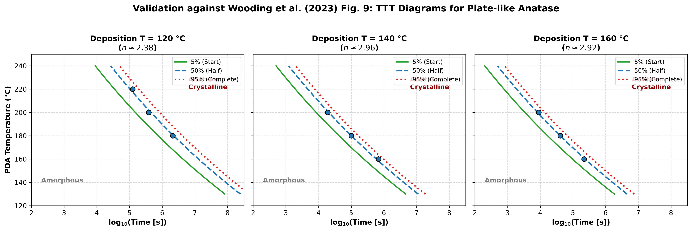
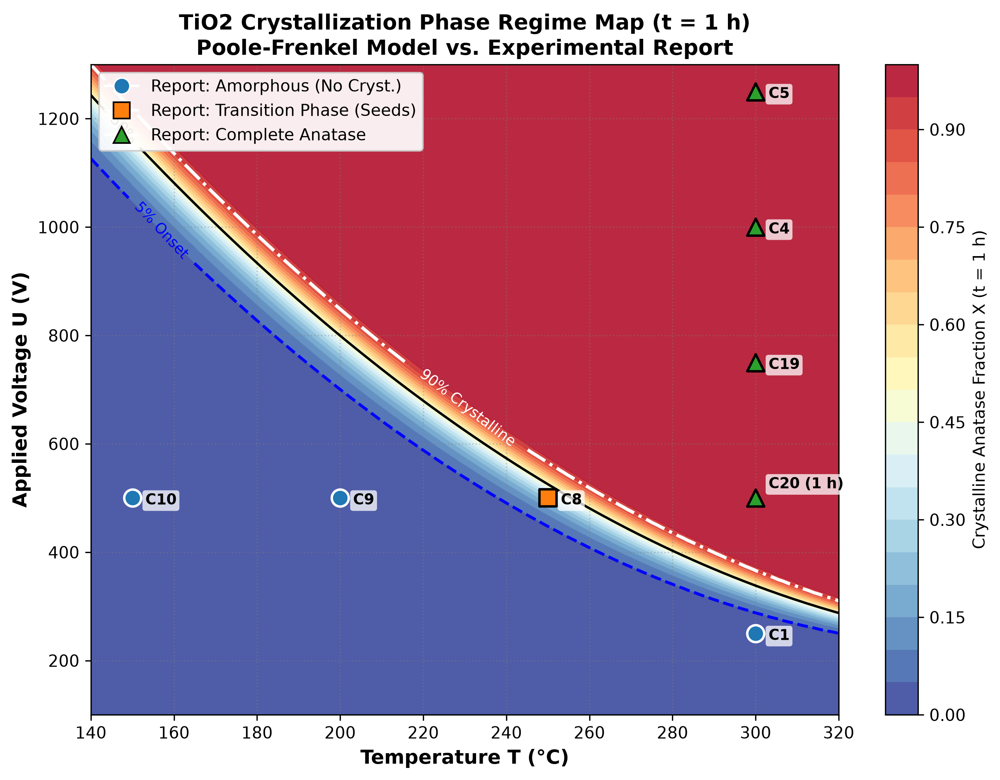
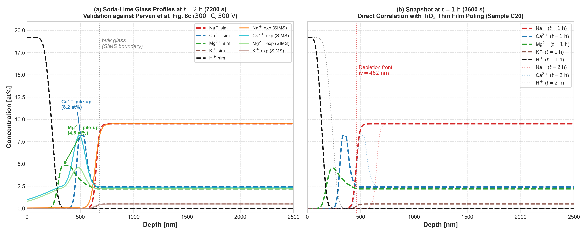
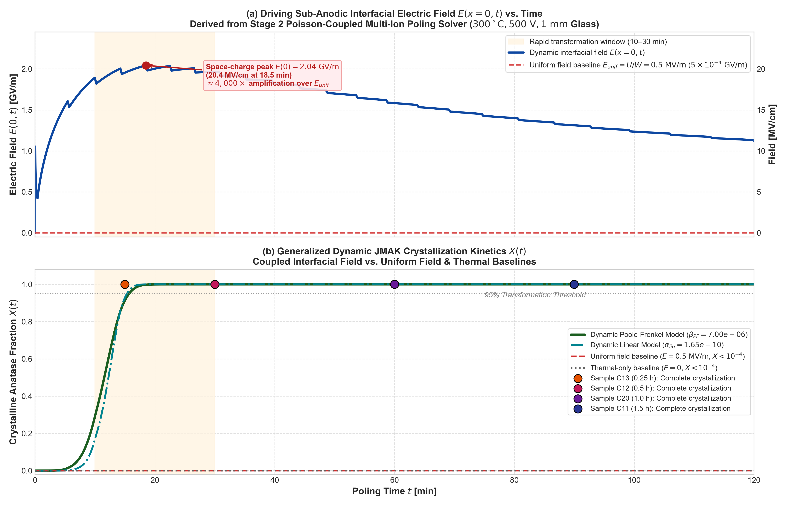

# $\text{TiO}_2$ Crystallization Kinetics & Thermal Poling Simulation Suite

A modular Python simulation suite for modeling amorphous-to-anatase phase transformations in titanium dioxide ($\text{TiO}_2$) thin films and field-assisted thermal poling of silicate glasses.

---

## Repository Structure

```
tio2 simulations/
├── src/
│   ├── __init__.py           # Package exports (SodaLimePoling1DSolver, CoupledJMAKSolver)
│   ├── params.py             # Physical constants, Wooding et al. dataset, poling experimental matrix
│   ├── avrami_jmak.py        # Stage 1: Analytical JMAK X(t), Arrhenius k(T), TTT diagrams, field-assisted k(T, E)
│   ├── avrami_2d.py          # Stage 1: 2D spatial nucleation-and-growth microstructure simulator
│   ├── ion_poling_1d.py      # Stage 2: 1D multi-ion drift-diffusion + Poisson solver for glass poling
│   └── coupled_kinetics.py   # Stage 3: Dynamic field-coupled JMAK crystallization solver
├── outputs/                  # High-resolution publication-quality PNG figures
│   ├── plot1_wooding_scurves.png
│   ├── plot2_wooding_ttt.png
│   ├── plot3_field_assisted_kinetics.png
│   ├── plot4_crystallization_regime_map.png
│   ├── plot5_avrami_2d_snapshots.png
│   ├── plot6_avrami_2d_verification.png
│   ├── plot7_sl_ion_profiles.png              # Stage 2: at% profiles vs depth (Pervan Fig. 6c validation)
│   ├── plot8_electric_field_evolution.png     # Stage 2: E(x, t) spatial profiles and E(0, t) time series
│   ├── interfacial_field_300C_500V.npz        # Stage 2: Exported interfacial field array
│   ├── plot9_coupled_avrami_vs_field.png      # Stage 3: Dynamic E(0, t) + X(t) with experimental markers
│   └── plot10_barrier_reduction_evolution.png # Stage 3: Activation barrier E_eff(t) over time
├── refs/                     # Reference literature (PDFs excluded via .gitignore)
│   ├── ALD-01-001_article-101276_en_1.pdf       (Wooding et al., ALDJ 2023)
│   ├── Report on Tio2 crystallization.pdf       (Bordeaux & IRB experimental study)
│   └── Modelling20accepted.pdf                  (Pervan et al., multi-ion glass poling)
├── run_stage1.py             # Main script: Stage 1 simulations and validation plots
├── run_stage2.py             # Main script: Stage 2 multi-ion glass poling and Poisson solver
├── run_stage3.py             # Main script: Stage 3 coupled kinetics and comparison plots
├── requirements.txt          # Python dependencies (numpy, scipy, matplotlib)
├── .gitignore                # Git exclusions (__pycache__, *.pyc, .vscode, .spyproject, refs/*.pdf)
└── README.md                 # Project documentation and guide
```

---

## Scientific Overview & Key Results

### Stage 1: Avrami (JMAK) $\text{TiO}_2$ Crystallization Kinetics
The isothermal transformed volume/area fraction $X(t)$ from amorphous to anatase $\text{TiO}_2$ follows the Johnson-Mehl-Avrami-Kolmogorov (JMAK) rate law:
$$X(t) = 1 - \exp\left(-(k \cdot t)^n\right)$$
where $k(T) = k_0 \exp\left(-\frac{E_a}{k_B T}\right)$ is governed by Arrhenius kinetics with activation energy $E_a \approx 1.48\text{ eV/atom}$ ($1.55\text{ eV}$ for $120\text{ }^\circ\text{C}$ ALD) and Avrami exponent $n \approx 2.75\text{--}3.0$, validating Wooding et al. (*Atomic Layer Deposition Journal*, 2023).

Analytical Time-Temperature-Transformation (TTT) diagrams accurately map the thermal processing window for $5\%$, $50\%$, and $95\%$ anatase transformation across post-deposition annealing (PDA) temperatures ($250\text{--}700\text{ }^\circ\text{C}$):



Under thermal poling, an external electric field lowers the crystallization barrier:
$$k(T, E) = k_0 \exp\left(-\frac{E_a - \Delta E(E)}{k_B T}\right)$$
Comparing Poole-Frenkel barrier lowering ($\Delta E_{PF} = \beta \sqrt{E}$) and linear electro-migration work ($\Delta E_{lin} = \alpha E$) delineates the crystallization regimes across temperature ($150\text{--}300\text{ }^\circ\text{C}$) and voltage ($0\text{--}1250\text{ V}$), matching experimental Raman outcomes for samples C1 through C20:



Furthermore, discrete 2D spatial simulation on a $500 \times 500$ grid models Poisson nucleation and isotropic radial expansion ($v$), demonstrating grain impingement and quantitatively verifying the theoretical Avrami exponent $n = 3.00$ ($R^2 > 0.999$).

---

### Stage 2: 1D Multi-Ion Drift-Diffusion + Poisson Solver for Glass Poling
Based on Petar Pervan et al. (*Modelling of concentration profiles in thermally poled glasses*, 2020), thermal poling of Menzel soda-lime glass at $300\text{ }^\circ\text{C}$ and $500\text{ V}$ over sample thickness $W = 1.0\text{ mm}$ is solved for 5 mobile species ($\text{Na}^+, \text{K}^+, \text{Ca}^{2+}, \text{Mg}^{2+}, \text{H}^+$):
$$\frac{\partial C_i}{\partial t} = -\mu_i \frac{\partial (E C_i)}{\partial x} + D_i \frac{\partial^2 C_i}{\partial x^2}$$
using modified Nernst-Einstein diffusion coefficients $D_i = \mu_i H k_B T / (q_i e)$ ($H = 0.3$, $\varepsilon_r = 7.0$).

The electric field $E(x, t)$ is computed by directly integrating Poisson's equation from the net ionic space charge density:
$$\frac{\partial E}{\partial x} = \frac{\rho(x, t)}{\varepsilon_0 \varepsilon_r}, \quad \rho(x, t) = e \sum_{i} q_i (C_i(x, t) - C_{i0})$$
subject to the constant-voltage integral constraint:
$$\int_0^W E(x, t)\, dx = U \quad (500\text{ V})$$

This formulation naturally resolves the physical field structure:
1. In the sub-anodic $\text{H}^+$-neutralized zone ($0\text{--}310\text{ nm}$), $\rho \approx 0 \implies \partial E / \partial x \approx 0$, yielding a **flat electric field profile**.
2. Across the space-charge boundary ($310\text{--}650\text{ nm}$), $E(x)$ smoothly drops into the bulk.
3. At early times, the $1\text{ mm}$ bulk carries the voltage drop ($E_{bulk} = 0.5\text{ MV/m}$); over time, the interfacial field $E(0, t)$ builds to a peak of $2.04\text{ GV/m}$ ($20.4\text{ MV/cm}$) at $t = 18.5\text{ min}$ before relaxing to $1.12\text{ GV/m}$ as $\text{Ca}^{2+}$ and $\text{Mg}^{2+}$ pile up at the depletion edge:



---

### Stage 3: Dynamic Interfacial Field Coupling into $\text{TiO}_2$ Crystallization
Stage 3 couples the time-varying interfacial field $E(0, t)$ exported from Stage 2 (`interfacial_field_300C_500V.npz`) into the generalized non-isothermal/dynamic JMAK integral:
$$X(t) = 1 - \exp\left( - \left[ \int_0^t k(T, E(t'))\, dt' \right]^n \right)$$

This demonstrates the physical mechanism of low-temperature field-assisted crystallization:
- A uniform external field ($E_{unif} = U/W = 0.5\text{ MV/m}$) or purely thermal annealing ($E = 0$) lowers the barrier by only $\sim 4.9\text{ meV}$, leaving the film completely amorphous ($X < 10^{-4}$).
- In contrast, the sub-anodic space-charge layer concentrates the entire potential drop across $\sim 600\text{ nm}$, amplifying the local interfacial field by $\sim 4,000\times$ to $2.04\text{ GV/m}$.
- This lowers the activation energy by $316\text{ meV}$ (from $1.55\text{ eV}$ down to $1.234\text{ eV}$), accelerating the crystallization rate by $> 5$ orders of magnitude and driving complete crystallization between $15\text{--}30\text{ min}$, in agreement with experimental samples C13 ($15\text{ min}$), C12 ($30\text{ min}$), C20 ($1\text{ h}$), and C11 ($1.5\text{ h}$):



---

## Installation & Requirements

Ensure Python 3.10+ is installed:
```bash
pip install -r requirements.txt
```

### Dependencies
- `numpy >= 1.24.0`
- `scipy >= 1.10.0`
- `matplotlib >= 3.7.0`

---

## How to Run

### Command Line
Run each simulation stage from the repository root:
```bash
# Stage 1: TiO2 crystallization kinetics, TTT diagrams, and 2D spatial impingement
python run_stage1.py

# Stage 2: 1D multi-ion drift-diffusion and Poisson solver for soda-lime glass poling
python run_stage2.py

# Stage 3: Dynamic interfacial field coupling into generalized JMAK kinetics
python run_stage3.py
```

### In Spyder or VS Code
Open the project directory in Spyder or VS Code, open any of the runner scripts (`run_stage1.py`, `run_stage2.py`, or `run_stage3.py`), and press **Run (F5)**. All paths are resolved relative to the workspace root.

---

## Summary of Generated Figures (`outputs/`)

| File | Stage | Description |
|---|---|---|
| `plot1_wooding_scurves.png` | Stage 1 | JMAK transformation curves $X(t)$ across PDA temperatures for ALD films deposited at 120, 140, and 160 °C (Wooding Fig. 4 reproduction). |
| `plot2_wooding_ttt.png` | Stage 1 | TTT diagrams (5%, 50%, 95% anatase transformation) on $T_{PDA}$ vs. $\log_{10}(t)$ axes (Wooding Fig. 9 reproduction). |
| `plot3_field_assisted_kinetics.png` | Stage 1 | Field-assisted kinetics comparing Linear vs. Poole-Frenkel barrier lowering across Voltage ($0\text{--}1250\text{ V}$), Temperature ($150\text{--}300\text{ }^\circ\text{C}$), and Time ($0\text{--}1.8\text{ h}$). |
| `plot4_crystallization_regime_map.png` | Stage 1 | Phase regime contour map in $(T, U)$ space overlaid with experimental samples C1–C20 (including C20 at 300 °C, 500 V, 1 h). |
| `plot5_avrami_2d_snapshots.png` | Stage 1 | 4-panel microstructural evolution showing early nucleation, circular grain growth, impingement, and polycrystalline anatase film. |
| `plot6_avrami_2d_verification.png` | Stage 1 | Quantitative verification of simulated area fraction $X_{sim}(t)$ against analytical Avrami ($n = 3.00$) and linearized Avrami fit. |
| `plot7_sl_ion_profiles.png` | Stage 2 | Multi-ion concentration profiles ($\text{Na}^+, \text{K}^+, \text{Ca}^{2+}, \text{Mg}^{2+}, \text{H}^+$) at $t = 2\text{ h}$ validating $\text{Na}^+$ depletion and $\text{Ca}^{2+}/\text{Mg}^{2+}$ pile-up against Pervan Fig. 6c, plus $t = 1\text{ h}$ snapshot. |
| `plot8_electric_field_evolution.png` | Stage 2 | Spatial profiles of $E(x, t)$ across multiple times ($1\text{ min}$ to $2\text{ h}$) with flat profile in $\text{H}^+$-neutralized zone, and peak interfacial field $E(0, t)$ vs. time. |
| `interfacial_field_300C_500V.npz` | Stage 2 | Exported time series of interfacial electric field $E(0, t)$ and depletion depth $w(t)$ for Stage 3 kinetic coupling. |
| `plot9_coupled_avrami_vs_field.png` | Stage 3 | Dynamic space-charge field $E(0, t)$ (peak $2.04\text{ GV/m}$ at $18.5\text{ min}$) driving $X(t)$ curve with experimental markers (C13, C12, C20, C11) vs. uniform and thermal baselines. |
| `plot10_barrier_reduction_evolution.png` | Stage 3 | Effective activation energy $E_{eff}(t) = E_a - \Delta E(E(t))$ showing maximum barrier reduction of $316\text{ meV}$ down to $1.234\text{ eV}$ during the first 30 minutes of poling. |
